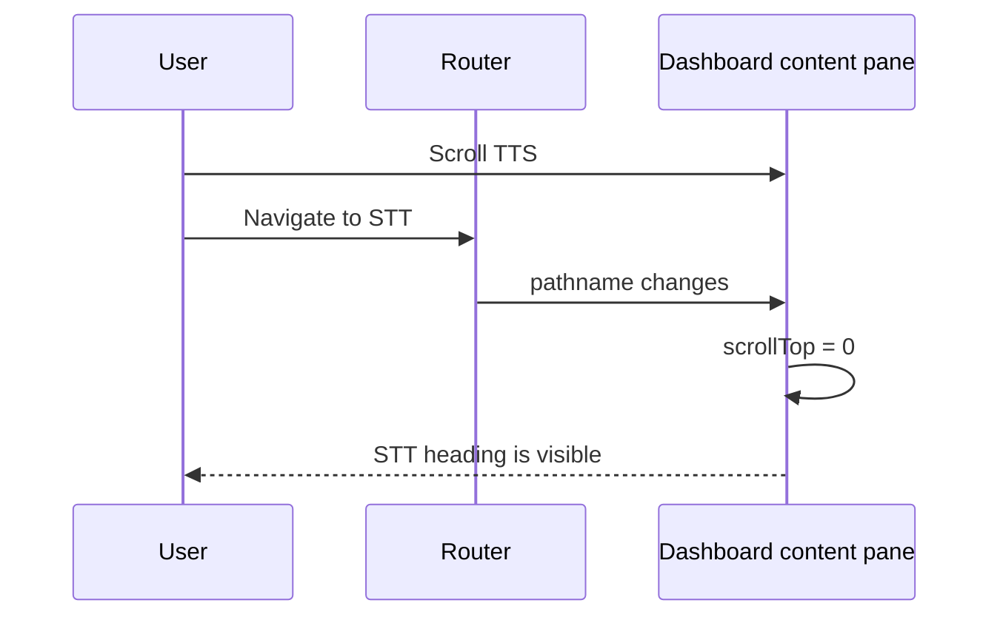

# Report — standalone playground scrolling and consistency

## Outcome

STT, LLM, and TTS now share one responsive workbench, remain contained on mobile, avoid a cramped
split at medium desktop widths, and open at the top after route navigation. STT users can replay the
exact accepted upload or completed recording before transcription.

## Root causes and fixes

| Proven cause | Fix |
|---|---|
| The implicit mobile grid track honored the form's 401.25 px min-content width inside 343 px. | `PlaygroundWorkbench` uses an explicit `minmax(0, 1fr)` track and `min-w-0` children. |
| The request/result split used viewport `lg`, ignoring the 256 px sidebar. | The split and sticky result now begin at `xl`. |
| The persistent dashboard outlet retained its scroll position between routes. | `DashboardLayout` resets its content scroller when `pathname` changes. |
| STT stored the selected/recorded `File` but exposed no playback. | `SttForm` creates a revocable object URL and renders native audio controls. |

## Scroll sequence

The reset is tied to the pathname, so opening controls or changing state within one playground does
not unexpectedly move the page.

## Verification

- 72 test files and 529 tests pass.
- Typecheck and production build pass.
- Targeted lint and `git diff --check` pass. Full lint remains at the documented baseline of 74
  errors and 8 warnings, none introduced in the changed files.
- Direct Chromium measurements confirm no 375 px workbench overflow and route scroll reset from
  333 to 0.
- All 15 STT/LLM/TTS browser checks pass at 375, 768, 1024, 1440, and 1920 px. Every screenshot was
  inspected: [after screenshots](../screenshots/2026-11-09-fix-standalone-playground-scroll/after/).

## Scope boundaries

Request payloads, services, API contracts, storage behavior, dependencies, and the intentionally
local horizontal scrolling in Code/Reference tabs were not changed. The existing bundle-size and
repository lint warnings remain out of scope.
